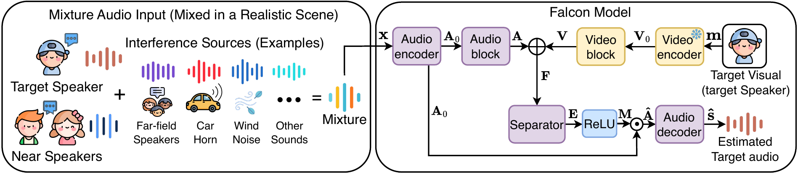
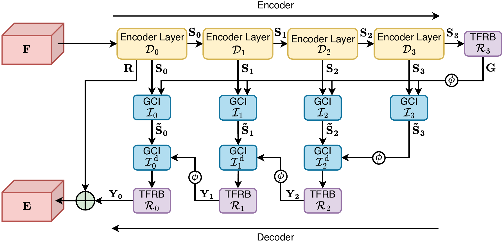
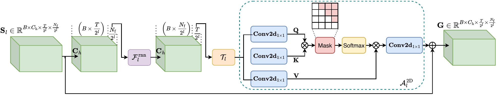
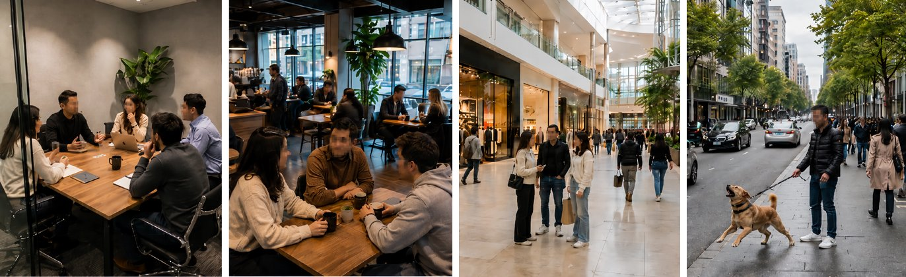

<div align="center">

<a href="https://github.com/JusperLee/Falcon">
  <picture>
    <source media="(prefers-color-scheme: dark)" srcset="assets/logo-tile.png">
    
  </picture>
</a>

<h1>Falcon</h1>
<p><strong>Efficient Streaming Audio-Visual Target Speaker Extraction<br>for Real-World Acoustic Scenes</strong></p>

**NeurIPS 2026** · [English](README.md) | **中文**

Wendi Sang<sup>\*</sup>, Kai Li<sup>\*</sup>, Yifan Li, Jianqiang Huang, Xiaolin Hu  
<sub><sup>\*</sup>共同第一作者</sub>

<p>
  <a href="https://cslikai.cn/Falcon/">项目主页</a> ·
  <a href="https://u464727-dmja-7896a455.bjb3.seetacloud.com:8443/">在线体验</a> ·
  <a href="https://huggingface.co/spaces/JusperLee/Falcon-Studio">Hugging Face Space</a> ·
  <a href="studio/README_zh.md">Falcon Studio</a>
</p>
<p>
  <strong>模型权重</strong> &nbsp;
  <a href="https://huggingface.co/JusperLee/Falcon">Falcon</a> ·
  <a href="https://huggingface.co/JusperLee/Falcon-Big">Falcon-Big</a>
  <br>
  <strong>数据集</strong> &nbsp;
  <a href="https://huggingface.co/datasets/JusperLee/RealSSA-Sim">RealSSA-Sim</a> ·
  <a href="https://huggingface.co/datasets/JusperLee/RealSSA-Real">RealSSA-Real</a>
</p>
<p>
  <a href="https://visitor-badge.laobi.icu/"></a>
  <a href="LICENSE"></a>
  
  
</p>

<sub>论文链接将在公开后补充。</sub>

</div>

> Falcon 是一个因果音视频目标说话人提取（AVTSE）模型，在单次编码器–解码器前向中完成分离。它以 0.5 M 可训练参数在 RealSSA、LRS2-2Mix、LRS3-2Mix 和 VoxCeleb2-2Mix 上取得最优效果，并能在笔记本电脑上实时用于视频会议。

## 💥 动态

- **[2026-10-21]** **Falcon Studio** 上线 [Hugging Face ZeroGPU Space](https://huggingface.co/spaces/JusperLee/Falcon-Studio)：在浏览器中录一段，再在 GPU 上分离。
- **[2026-10-20]** 开源训练、评测与推理代码，并发布 **Falcon Studio**：可接入 Zoom / 腾讯会议的实时演示。
- **[2026-09-24]** Falcon 被 **NeurIPS 2026** 接收。

## 🧩 概述

通话、会议和助听等对延迟敏感的应用都需要流式 AVTSE。现有因果系统面临两个相互关联的缺口：一方面，常用基准把说话人数固定为两人，忽略了近场/远场干扰、混响和突发噪声；另一方面，性能强的因果架构对边缘设备来说太重，而轻量方案靠多次调用小型分离器来弥补容量，又抵消了节省下来的计算。

- **RealSSA** 是一个真实感模拟场景的 AVTSE 基准，在四类场景中包含近场/远场干扰语音，并配有一个真实录制的评测集。
- **Falcon** 是一个因果 AVTSE 框架。其 AudioBlock 在单次编码器–解码器中完成多尺度时频分离。
- **编码器空间说话人对比损失** 抑制近场串音，不增加任何推理开销，并且可以迁移到其他主干网络。
- 与因果 AV-TFGridNet 基线相比，Falcon 的参数量减少 91.9%，计算量降低 20.2 倍，GPU 推理延迟降低 11.1 倍。

<p align="center">
  
  <br><em>Falcon 音视频目标说话人提取的整体流程。</em>
</p>

<p align="center">
  
  <br><em>单次多尺度分离器。φ 表示上采样操作。</em>
</p>

<p align="center">
  
  <br><em>时频细化块（TFRB）。</em>
</p>

## 🌆 RealSSA 基准

已发布的 RealSSA 基准包含两个互补的数据集：

| 数据集 | 内容 | 划分 | 获取与使用 |
|---|---|---|---|
| [**RealSSA-Sim**](https://huggingface.co/datasets/JusperLee/RealSSA-Sim) | 模拟场景；4 通道 16 kHz 混合语音与目标语音、RGB 嘴部裁剪及场景元数据 | 训练 100,826 / 验证 9,133 / 测试 9,169 条 | 申请访问、人工审核；CC BY-NC-ND 4.0 及各来源条款 |
| [**RealSSA-Real**](https://huggingface.co/datasets/JusperLee/RealSSA-Real) | 40 段逻辑录音对应 54 段音视频配对输入；10 位说话人、8 种场景，共 83.99 分钟 | 仅测试集；另有包含 34 段录音的原始录音视图 | 申请访问、人工审核；遵守数据卡中的科研使用条件 |

RealSSA-Sim 包括 `small_meeting`、`medium_indoor`、`large_public`、`outdoor` 四类场景，使用静态声源，包含近场/远场干扰语音、环境噪声与突发事件，以 240 个 WebDataset TAR 分片发布。RealSSA-Real 提供双声道 16 kHz 音频、25 fps 目标人脸视频、嘴部裁剪、关键点、说话人注册语音和录音级转写。注册语音是独立的说话人参考，不是可用于 SI-SDR 的时间对齐干净目标。

**先阅读数据卡**，其中包含下载、文件格式、通道选择、时间对齐及推理示例。发布的多通道分片需要适配后才能用于当前单声道、目录式训练加载器；Sim 元数据中的源路径仅用于追溯生成输入，不提供可直接下载的近场说话人波形。原始说话人对比训练还需要这些源信号。代码和权重的许可不替代数据集的访问与使用条款。

<p align="center">
  
  <br><em>促成 RealSSA 的真实场景。从左到右：小房间、咖啡馆、商场、户外街道。</em>
</p>


## ⚡ 安装

仓库分为两部分，各自使用独立的环境：

| 部分 | 目录 | 用途 |
|---|---|---|
| 训练与评测 | 仓库根目录 | 训练 Falcon，并在 LRS2/LRS3/VoxCeleb2/RealSSA 格式的数据上评测（`look2hear/`） |
| Falcon Studio | [`studio/`](studio/README_zh.md) | 在浏览器和视频会议中实时分离、离线处理录音、Python API |

```bash
git clone https://github.com/JusperLee/Falcon.git
cd Falcon

# 训练与评测（PyTorch >= 1.13，建议使用 CUDA）
pip install -r requirements.txt

# 只用 Falcon Studio（Python 3.10-3.12；支持 Apple Metal、NVIDIA CUDA 和 CPU）
pip install -r studio/requirements.txt
```

## 📦 模型权重

| 模型 | Hugging Face | 文件 | 配置 | 音频网络 | 总参数量* | 用途 |
|---|---|---|---|---|---|---|
| **Falcon**（论文模型） | [`JusperLee/Falcon`](https://huggingface.co/JusperLee/Falcon) | `falcon.pt` | `configs/Falcon.yml` | `FalconSpeakerContrastive` | 11.72 M | 论文结果，Studio 默认模型 |
| **Falcon-Big** | [`JusperLee/Falcon-Big`](https://huggingface.co/JusperLee/Falcon-Big) | `falcon-big.pt` | `studio/configs/FalconBig.yml` | `SpeakerContrastiveV2`（更宽） | 12.35 M | Studio 的 Big 选项，仅用于推理 |

\*包含冻结的 11.2 M 参数 FRCNN 唇读编码器。论文只统计可训练参数（Falcon 为 0.5 M）。

不需要手动下载权重。Falcon Studio、`infer_file.py` 和 `FalconRuntime.from_pretrained` 会在首次使用时通过上面的 Hugging Face 短链下载权重，并缓存在 `~/.cache/huggingface`。访问 huggingface.co 较慢或无法访问时，可以设置镜像，例如 `export HF_ENDPOINT=https://hf-mirror.com`。也可以用 `--checkpoint` 传入本地文件，例如用 `hf download JusperLee/Falcon falcon.pt --local-dir weights` 下载的文件。

权重文件只包含 `audio_model.*` 和 `video_model.*` 的参数。训练时还需要把预训练视觉主干 `frcnn_128_512.backbone.pth.tar` 放到 `pretrain_zoo/`（见下文「训练与评测」）。

## 🎧 推理

### Falcon Studio：实时分离与视频会议

本页顶部有两个在线版：「在线体验」在 GPU 服务器上运行 Falcon Studio，实时分离；[Hugging Face Space](https://huggingface.co/spaces/JusperLee/Falcon-Studio) 先录最长 60 秒，再在 ZeroGPU 上按实时工作台的窗口分离。Space 的代码在 [`space/`](space/README_zh.md)。

Falcon Studio 在本机运行模型，在浏览器中用 MediaPipe 跟踪说话人的嘴部，把分离后的声音播放到耳机，或通过虚拟音频设备（BlackHole）送入 Zoom / 腾讯会议。在 macOS 上双击 `studio/Start Falcon.command`，或运行：

```bash
cd studio
./scripts/launch.sh
```

安装、会议接线和故障排查见 [`studio/README_zh.md`](studio/README_zh.md)（[English](studio/README.md)）。模型每次处理 2 秒音视频窗口，每个步长输出新的 0.5 秒；在 Apple M5 Pro 上，一个窗口用 Metal 约需 0.12 秒。在带 NVIDIA GPU 的 Linux 上使用 `--device cuda`（`auto` 会优先选择 CUDA）。

### 离线处理一段录音

```bash
cd studio
ffmpeg -i input.mp4 -ac 1 -ar 16000 mix.wav
python infer_file.py --audio mix.wav --mouth mouth.npy --out target.wav --model JusperLee/Falcon
```

`mouth.npy` 是目标说话人 25 fps 的 96×96 灰度嘴部裁剪，形状为 `(T, 96, 96)`，格式与训练数据相同（也支持 `.npz` 和 `.pt`）。整段录音一次处理完。

### Python API

```python
import numpy as np
from falcon_runtime import FalconRuntime  # 在 studio/ 目录下运行

model = FalconRuntime.from_pretrained("JusperLee/Falcon")  # 或 "JusperLee/Falcon-Big"；device="auto"、"cuda"、"mps" 或 "cpu"
audio = np.zeros(32000, dtype=np.float32)              # 2 秒 16 kHz 单声道混合语音
mouth = np.zeros((50, 96, 96), dtype=np.uint8)         # 25 fps 的 50 帧灰度嘴部裁剪
target = model.infer(audio, mouth)                     # (32000,) float32 目标语音
```

## 🏋️ 训练与评测

数据沿用 LRS2/LRS3 的目录结构：`tr/`、`cv/` 和 `tt/` 下分别有 `mix/`、`target/` 两个 WAV 文件夹（16 kHz）和目标说话人的嘴部裁剪。先生成 JSON 索引：

```bash
DATA=/path/to/data      # 包含 tr/ cv/ tt/
INDEX=/path/to/index    # JSON 文件的输出目录

python DataPreProcess/process_lrs23.py --in_audio_dir $DATA --out_dir $INDEX
python DataPreProcess/generate_near_json.py --data_root $DATA --out_root $INDEX --sample_rate 16000
```

`process_lrs23.py` 为每个划分生成 `mix.json` 和 `target.json`。`generate_near_json.py` 生成 `near.json`，索引近场干扰说话人，作为说话人对比损失的负样本。然后修改 `configs/Falcon.yml`：把 `datamodule.data_config.train_dir`、`valid_dir` 和 `test_dir` 分别设为 `$INDEX/tr`、`$INDEX/cv` 和 `$INDEX/tt`（脚本不会展开环境变量）。再把唇读预训练的视觉主干 `frcnn_128_512.backbone.pth.tar` 放到仓库根目录的 `pretrain_zoo/`。<!-- TODO: 补充主干权重的下载链接。 -->

```bash
# 训练（DDP，AdamW 学习率 1e-3，ReduceLROnPlateau，早停 30，梯度裁剪 5）
python audio_train.py --conf_dir configs/Falcon.yml

# 在测试集上评测 SI-SDR / SDR（单卡或多卡）
python audio_visual_test.py --conf_dir Experiments/checkpoint/Falcon/conf.yml --gpus 0

# 直接评测 Hugging Face 上发布的权重
python audio_visual_test.py --conf_dir Experiments/checkpoint/Falcon/conf.yml --ckpt_path hf://JusperLee/Falcon/falcon.pt --gpus 0

# 参数量与 MACs
python evaluated_mac_params.py
```

评测从该 `conf.yml` 读取数据路径（同样需要修改）。不指定 `--ckpt_path` 时，会加载 `Experiments/checkpoint/<exp_name>/` 中最好的 checkpoint：优先取 `best_k_models.json` 中验证损失最低的一项，没有时用 `last.ckpt`，再没有时用最后一个 `epoch=*.ckpt`。结果写入 `Experiments/checkpoint/Falcon/results/metrics_combined.csv`。训练代码（`look2hear/`）和 Studio 运行时（`studio/falcon_model/`）在 `falcon.pt` 上的输出完全一致；Studio 中的副本只去掉了训练期依赖，并为 Apple Metal 增加了 CPU FFT 转接（见 [`PROVENANCE.md`](studio/falcon_model/PROVENANCE.md)）。

## 📊 实验结果

因果 AVTSE 方法对比（SI-SNRi / SDRi，单位 dB；DNSMOS 在真实录制集上计算）。**粗体**为每列最优。

| 方法 | RealSSA SI-SNRi | SDRi | LRS2-2Mix SI-SNRi | SDRi | LRS3-2Mix SI-SNRi | SDRi | VoxCeleb2-2Mix SI-SNRi | SDRi | 真实场景 DNSMOS |
|---|---|---|---|---|---|---|---|---|---|
| AV-ConvTasNet | 1.2 | 2.6 | 9.8 | 10.3 | 12.5 | 12.8 | 6.9 | 8.2 | 2.580 |
| AV-Sepformer | 5.5 | 6.3 | 10.6 | 11.1 | 13.4 | 13.7 | 6.9 | 8.3 | 2.813 |
| AV-TF-GridNet | 7.6 | 8.1 | 12.7 | 13.1 | 14.3 | 14.8 | 5.8 | 7.7 | 3.030 |
| RTFSNet-12 | 4.9 | 5.7 | 12.4 | 12.8 | 14.0 | 14.4 | 8.4 | 10.7 | 3.066 |
| CTCNet | 5.4 | 6.2 | 8.0 | 8.8 | 9.4 | 10.2 | 2.5 | 4.7 | 2.840 |
| AV-DPRNN | 5.4 | 6.2 | 10.2 | 10.7 | 11.9 | 12.3 | 7.8 | 9.0 | 2.901 |
| AV-Mossformer2 | 6.0 | 6.7 | 13.2 | 13.9 | 16.2 | 16.6 | 7.7 | 9.1 | 2.912 |
| Swift-Net-12 | 7.3 | 7.8 | 13.9 | 14.1 | 16.0 | 16.3 | 9.4 | 10.8 | **3.276** |
| Dolphin | 6.7 | 7.3 | 14.0 | 14.6 | 14.3 | 14.9 | 9.2 | 11.1 | 2.960 |
| **Falcon（本文）** | **7.7** | **8.2** | **14.1** | **14.7** | **16.4** | **16.7** | **10.5** | **11.8** | **3.276** |

效率对比：输入为 2 秒 16 kHz 音频和 50 帧嘴部图像（RTX 3090 / Intel Xeon，batch size 为 1；只统计可训练参数）：

| 方法 | 参数量 (M) | MACs (G) | CPU 延迟 (ms) | GPU 延迟 (ms) | 内存 (MB) | GPU 显存 (MB) |
|---|---|---|---|---|---|---|
| AV-ConvTasNet | 11.0 | 15.0 | 674.4 | 13.3 | 100.0 | 241.8 |
| AV-Sepformer | 39.7 | 226.5 | 5143.0 | 53.9 | 178.0 | 369.7 |
| AV-TF-GridNet | 6.2 | 213.8 | 5646.3 | 567.8 | 136.3 | 1015.8 |
| RTFSNet-12 | 0.6 | 67.0 | 4149.3 | 164.7 | 457.9 | 411.7 |
| CTCNet | 6.8 | 150.1 | 3267.4 | 162.8 | 233.2 | 216.5 |
| AV-DPRNN | 1.3 | **4.5** | **271.0** | **5.8** | **73.0** | **192.4** |
| AV-Mossformer2 | 56.7 | 224.2 | 16670.7 | 114.9 | 330.9 | 539.8 |
| Swift-Net-12 | **0.5** | 45.3 | 4163.8 | 172.1 | 482.3 | 411.7 |
| Dolphin | 5.6 | 18.1 | 2411.0 | 87.9 | 560.2 | 390.3 |
| **Falcon（本文）** | **0.5** | 10.6 | 1361.2 | 51.3 | 125.3 | 364.7 |

Dolphin 和 AV-Mossformer2 在我们的训练流程下重新实现为因果版本；其余基线采用 Swift-Net 报告的数值。消融实验和真实场景 NISQA 结果见论文。

## 🗂️ 目录结构

```
Falcon/
├── audio_train.py            # 训练入口（PyTorch Lightning，DDP）
├── audio_visual_test.py      # SI-SDR / SDR 评测，单卡或多卡
├── evaluated_mac_params.py   # 参数量与 MACs
├── configs/Falcon.yml        # 论文配置
├── DataPreProcess/           # 生成 mix/target/near JSON 索引
├── look2hear/                # 模型、视频模型、网络层、损失、数据集、Lightning 系统、指标
├── Experiments/checkpoint/   # 配置快照与最优 checkpoint 记录（权重需另行下载）
├── assets/                   # README 图片
├── project_page/             # 项目主页与 demo 样例（https://cslikai.cn/Falcon/；音视频在 oss.cslikai.cn）
├── space/                    # Hugging Face ZeroGPU Space：先录制、再分离（build.py 与 studio/ 一起组装）
└── studio/                   # Falcon Studio
    ├── server.py             # 本地 FastAPI + WebSocket 推理服务
    ├── falcon_runtime.py     # Hugging Face 权重下载、严格加载、2 秒窗口推理
    ├── infer_file.py         # 离线整段推理命令行
    ├── falcon_model/         # 模型代码的推理副本（见 PROVENANCE.md）
    ├── configs/              # Falcon.yml（Small）与 FalconBig.yml（Big）
    ├── web/                  # 浏览器界面：采集、嘴部跟踪、播放、会议输出
    ├── scripts/              # 启动、环境安装、BlackHole 安装
    └── tests/                # Python、Node 与浏览器测试
```

## 📝 引用

```bibtex
@inproceedings{sang2026falcon,
  title     = {Efficient Streaming Audio-Visual Target Speaker Extraction for Real-World Acoustic Scenes},
  author    = {Sang, Wendi and Li, Kai and Li, Yifan and Huang, Jianqiang and Hu, Xiaolin},
  booktitle = {Advances in Neural Information Processing Systems (NeurIPS)},
  year      = {2026}
}
```

## 📄 许可证

代码和发布的权重采用 [Apache License 2.0](LICENSE)。Falcon Studio 附带 MediaPipe Tasks Vision 及其人脸关键点模型（`studio/web/vendor/mediapipe`），由 Google 以 Apache License 2.0 发布，并保留其自身的声明。LRS2、LRS3 和 VoxCeleb2 遵循各自的许可，本仓库不重新分发这些数据。

## 🙏 致谢

冻结的视觉编码器沿用 [CTCNet](https://github.com/JusperLee/CTCNet)。基线数值来自 [Swift-Net](https://github.com/JusperLee/Swift-Net)，其中 [Dolphin](https://github.com/JusperLee/Dolphin) 和 [AV-MossFormer2](https://github.com/modelscope/ClearerVoice-Studio) 为我们重新实现的因果版本。Falcon Studio 的实时嘴部跟踪使用 [MediaPipe Face Landmarker](https://ai.google.dev/edge/mediapipe/solutions/vision/face_landmarker)。
