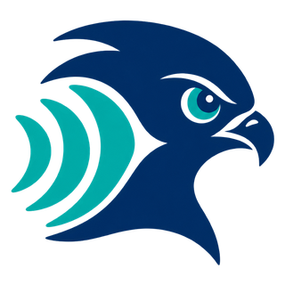

<p align="center">
  <a href="https://github.com/JusperLee/Falcon">
    <picture>
      <source media="(prefers-color-scheme: dark)" srcset="../assets/logo-tile.png">
      
    </picture>
  </a>
</p>

# Falcon Studio

[English](README.md) | **中文**

> 本目录是 [Falcon](../README.md) 仓库的实时演示部分。论文、训练与评测代码见仓库根目录 README。

> **🎙️ 在线体验：** <https://u464727-dmja-7896a455.bjb3.seetacloud.com:8443/>（Chrome）。在线版运行在 GPU 服务器上，摄像头和麦克风数据会发送到该服务器。本文其余部分介绍本地安装。

Falcon Studio 在 Mac 或带 NVIDIA GPU 的 Linux 上实时运行 Falcon 音视频目标说话人提取。浏览器采集麦克风和摄像头并跟踪说话者的嘴部；本机 Python 服务运行模型，把分离出的目标语音送回浏览器，用于耳机监听、录音，或接入视频会议（Zoom / 腾讯会议）。

全部在本机运行：界面、字体、脚本和 MediaPipe 人脸跟踪模型都随项目提供，不依赖 CDN。应用默认打开 `http://127.0.0.1:7860`，端口被占用时在 7860–7899 中选择下一个空闲端口。摄像头和麦克风数据只发送给本机服务，不写入磁盘。开启会议输出后，分离语音会送到你选择的虚拟音频设备，再由会议应用传输。

## 快速开始

1. 在 Finder 中双击 **Start Falcon.command**。首次运行会检查环境、安装缺少的依赖，并从 Hugging Face 下载权重。
2. 浏览器自动打开后，等待模型加载和预热完成。
3. 点击 **开启设备**，允许摄像头和麦克风访问。
4. 默认使用 **自动跟踪**。正对摄像头、露出嘴部，等绿色嘴部轮廓和 **AUTO** 取景框跟上后，点击 **开始分离**。
5. 想实时听到结果时，先戴上耳机，再打开 **耳机实时监听**（默认关闭）。
6. 停止后可以 **试听** 或 **导出 WAV**。在 **分离结果** 和 **原始混合** 之间切换，可以试听或保存分离后的声音，或者模型收到的麦克风原始输入，两者按同一时刻对齐。浏览器最多保留 5 分钟可导出的录音；超过后实时分离和会议输出仍会继续。
7. 界面中的 **停止** 会先把最后约 1 秒的语音分离完，再释放设备（再点一次立即停止）；退出整个应用时，在终端窗口按 **Control-C**。

界面首次打开为英文，可随时在右上角切换 **English / 中文**。切换语言不会中断采集、更换模型或清空录音。

## 模型

| 模型 | Hugging Face | 说明 |
|---|---|---|
| Falcon（默认） | [`JusperLee/Falcon`](https://huggingface.co/JusperLee/Falcon) | 论文模型，速度最快 |
| Falcon-Big | [`JusperLee/Falcon-Big`](https://huggingface.co/JusperLee/Falcon-Big) | 更宽的变体，容量更大 |

在 **分离引擎** 中选择模型（菜单中显示为 Falcon Small / Falcon Big），切换前先停止分离。首次加载某个模型时，会通过 Hugging Face 短链下载权重，缓存在 `~/.cache/huggingface`，之后可以离线运行。访问 huggingface.co 较慢或无法访问时，可以使用镜像：

```bash
HF_ENDPOINT=https://hf-mirror.com ./scripts/launch.sh
```

权重按模型配置严格加载。不匹配时会直接报错，不会把未处理的混音当作分离结果播放。

## 嘴部跟踪

**自动跟踪** 在 Worker 中运行随项目提供的 MediaPipe Face Landmarker，让嘴部取景框跟着说话者移动；摄像头画面不会离开本机。

- **正在跟踪**：正对摄像头、光线充足、嘴部完整可见；正常的头部移动没有问题。
- **人脸丢失**：分离不暂停。取景框停在最后看到嘴部的位置，状态显示「未检测到人脸 · 沿用上次取景」。这段时间模型看不到嘴部动作，效果可能变差。人脸回到原位置附近后，连续 4 帧一致即自动跟上，不需要点击。
- **目标移动很远**：画面其他位置出现的人脸需要稳定约 2.5 秒才会成为新目标，在此之前取景框和输出保持不变。同时出现多张无法确认的人脸时，会提示点击 **重新捕捉**。随时点击 **重新捕捉** 也可以立即重新选择目标。
- **手动覆写**：选择 **手动框选**，或直接拖动取景框。拖右下角调整大小，方向键移动，`+` / `-` 调整尺寸。手动模式不会判断框内是否还有人脸；选择 **自动跟踪** 即可恢复。

跟踪依据的是位置，不是身份识别。镜头中请只保留一位目标说话者。如果别人坐到同一位置，或目标长时间侧脸、被遮挡，取景框可能跟到别人的嘴部；点击 **重新捕捉** 后，确认框落在正确的说话者上。

## 接入 Zoom / 腾讯会议

会议模式把分离后的语音送入虚拟麦克风。推荐 **Chrome + BlackHole 2ch + 耳机**。

```text
物理麦克风 + 摄像头 → Falcon → BlackHole 2ch → 会议应用麦克风
                              ↘ 可选的耳机监听
会议对方的声音 ─────────────────────────────→ 耳机
```

[BlackHole](https://github.com/ExistentialAudio/BlackHole) 是 macOS 音频驱动，能把一个应用的输出变成另一个应用的输入。首次使用时双击 **Setup Meeting Audio.command** 安装，或运行 `./scripts/install-blackhole.sh`（加 `--check` 只查看状态）。它使用 Homebrew 的 `blackhole-2ch`，可能需要管理员密码，安装后需要**重启 macOS**。普通启动不会安装任何驱动。

每次开会前：

| 设置位置 | 设备 |
|---|---|
| Falcon 输入麦克风 | 你的物理麦克风 |
| Falcon **会议输出设备** | BlackHole 2ch，并打开 **启用会议输出** |
| 会议应用麦克风 | BlackHole 2ch |
| 会议应用扬声器 | 耳机 |
| macOS 声音输出 | 耳机 |

不要把 macOS 输出、会议扬声器或 Falcon 输入设为 BlackHole，否则对方会听到自己的声音。**耳机实时监听** 只决定你自己是否听到结果，关闭它也能向会议输出。开会前先用会议应用的麦克风测试确认。如果对方觉得声音被处理过，把会议应用自带的降噪和自动调节麦克风音量关掉，避免它再处理一遍分离后的声音。

Chrome 在切换到会议窗口后仍会继续采集摄像头画面；其他浏览器只能前台采集，需要保持 Falcon 页面可见。Studio 只转接音频，不提供虚拟摄像头，会议里的画面不会为了对齐分离语音而延迟。

## 实时处理流程

| 环节 | 实现 |
|---|---|
| 音频 | 麦克风重采样为 16 kHz 单声道 |
| 视频 | 每秒 25 帧；自动或手动的嘴部取景缩放为 96×96 灰度图，模型内居中裁剪为 88×88 |
| 窗口 | 最近 2 秒音视频 |
| 步长 | 0.5 秒；每次播放最新的 0.5 秒，保留 80 ms 右侧上下文 |
| 拼接 | 相邻输出短暂交叉淡化；以带限重采样转换到设备采样率 |
| 过载 | 有界队列；算不过来时跳过过时窗口，不让延迟累积 |

首次输出需要约 0.58 秒有效输入，再加上计算时间。每次开始或重新锁定目标时，在左侧补 1.42 秒静音并沿用该目标的首帧有效嘴部画面，使第一段输出从真实采集起点开始，不再丢弃开头的字；补入的上下文不写入两条录音。录制不足一个步长时点停止，也会补齐并处理，保存长度截至点击停止的时刻。起始段的分离质量可能与拥有完整真实上下文的窗口不同。稳态的设计延迟约 0.7–0.8 秒（0.5 秒步长 + 80 ms 上下文 + 推理 + 播放缓冲）。模型没有可复用的流式状态，每一步都重新计算完整的 2 秒窗口，所以这是滑动窗口推理，不是原生流式模型。在 Apple M5 Pro 上，一个 2 秒窗口在 Metal 上约 0.12 秒，在 CPU 上约 0.65 秒，CPU 可能需要跳过部分窗口。

自动跟踪得到的是关键点引导的方形嘴部裁剪，不是生成训练数据时的完整人脸对齐，因此实时输入和训练条件会有差异。大幅转头、遮挡和光照变化都可能降低效果。

输入和输出面板显示最近约 8 秒的滚动频谱（0–8 kHz，−90 至 0 dBFS）。停止后，点击波形、频谱或进度条即可从任意位置试听。录音和频谱只保存在页面内存中，关闭页面即清除；需要保留时请 **导出 WAV**。

## 命令行

以下命令在 `studio/` 目录运行：

```bash
./scripts/launch.sh                              # 自动选择 Metal 或 CPU，并打开浏览器
./scripts/launch.sh --device cuda                # 或 --device mps / --device cpu
./scripts/launch.sh --model JusperLee/Falcon-Big # 启动时加载 Falcon-Big
./scripts/launch.sh --port 7861 --no-browser
./scripts/doctor.sh                              # 检查依赖、Metal / CUDA 和模型下载状态
```

`auto` 依次尝试 CUDA、Metal，GPU 预热失败时退回 CPU。在 Linux 上，先安装 CUDA 版 PyTorch（见 pytorch.org）和依赖，然后运行 `python server.py --device cuda`，用 Chrome 打开终端里显示的地址；`.command` 启动入口和 BlackHole 仅适用于 macOS。启动脚本会复用本目录中可用的 `.venv`，否则安装到 iCloud 之外的 `~/Library/Caches/FalconStudio/venv`，并优先使用固定版本的 `requirements-lock.txt`。支持 Python 3.10–3.12（推荐 3.11）；可用 `FALCON_PYTHON=/path/to/python3.11` 指定解释器，用 `FALCON_VENV=/path` 指定环境目录，用 `./scripts/bootstrap.sh` 只安装不启动。

### 离线处理一段录音

```bash
ffmpeg -i input.mp4 -ac 1 -ar 16000 mix.wav
python infer_file.py --audio mix.wav --mouth mouth.npy --out target.wav --model JusperLee/Falcon
```

`mouth.npy` 是目标说话者 25 fps 的 96×96 灰度嘴部裁剪，形状为 `(T, 96, 96)`（也支持 `.npz` 和 `.pt`）。`--checkpoint` 可以传入本地权重文件或 `hf://<org>/<repo>/<file>`，代替模型默认的权重。

### Python API

```python
import numpy as np
from falcon_runtime import FalconRuntime

model = FalconRuntime.from_pretrained("JusperLee/Falcon")  # 或 "JusperLee/Falcon-Big"；device="auto" | "cuda" | "mps" | "cpu"
audio = np.zeros(32000, dtype=np.float32)                  # 2 秒 16 kHz 单声道混合语音
mouth = np.zeros((50, 96, 96), dtype=np.uint8)             # 25 fps 的 50 帧嘴部裁剪
target = model.infer(audio, mouth)                         # (32000,) 目标语音
```

## 故障排查

**双击没有反应。** 在终端运行 `./scripts/launch.sh` 查看错误。如果脚本丢失了执行权限：`chmod +x "Start Falcon.command" "Setup Meeting Audio.command" scripts/*.sh`。

**权重下载不下来。** 检查网络后用镜像重试：`HF_ENDPOINT=https://hf-mirror.com ./scripts/launch.sh`；或用 `--checkpoint` 指定已下载的文件。

**没有摄像头或麦克风画面。** 用普通浏览器窗口打开终端里显示的 `127.0.0.1` 地址（端口可能是 7861 或更高）。在「系统设置 → 隐私与安全性 → 摄像头 / 麦克风」中允许该浏览器，然后重启浏览器。关闭可能占用设备的会议软件。

**有画面但没有声音。** 等模型就绪、首个窗口完成。自动模式开始时需要先找到一次人脸。监听默认关闭；确认系统输出是你的耳机。

**跟踪锁不住，或跟错了人。** 镜头中只保留一张无遮挡的脸，避免逆光和侧脸，点击 **重新捕捉**。仍不稳定时使用 **手动框选**。

**回声或啸叫。** 关闭监听并使用耳机；扬声器放出的分离语音会被麦克风再次收录。

**strict / missing / unexpected keys 报错。** 权重和所选模型的配置不匹配。请使用对应的 Falcon / Falcon-Big 权重，不要关闭严格加载。

**会议应用收不到声音。** 确认 **启用会议输出** 已打开且设备为 BlackHole 2ch，会议应用的麦克风也选了 BlackHole 2ch。安装 BlackHole 后需重启 macOS、浏览器和会议应用。会议输出不可用时请改用 Chrome。

**GPU（Metal / CUDA）报错、卡顿或持续过载。** 用 `--device cpu` 重新启动，关闭其他占用资源的程序，只保留一个 Falcon 页面。推理持续超过 500 ms 预算时，过时窗口会被丢弃，输出可能出现间断。

**端口被占用。** 不指定 `--port` 时会在 7860–7899 中选择下一个空闲端口；指定 `--port` 时严格使用该端口。关闭浏览器页面不会停止服务，需要在终端按 Control-C。

**依赖损坏。** 重新运行 `./scripts/bootstrap.sh`，或用 `FALCON_VENV=/new/path` 安装到新的环境。

## 目录结构

```text
Start Falcon.command         Finder 启动入口
Setup Meeting Audio.command  可选的 BlackHole 安装入口
server.py                    本地 FastAPI + WebSocket 服务、窗口拼接
falcon_runtime.py            权重下载、严格加载、预处理与推理
infer_file.py                离线整段推理
falcon_model/                模型代码的推理副本（见 PROVENANCE.md）
configs/                     Falcon.yml 与 FalconBig.yml
web/                         界面：采集、嘴部跟踪、播放、会议输出
scripts/                     启动、环境安装、BlackHole 安装
tests/                       Python、Node 与浏览器测试
```

服务提供 `GET /api/status`、`POST /api/load` 和 `/ws`，只允许本机同源页面访问。

## 测试

```bash
pip install -r requirements-dev.txt
python -m pytest tests/
for t in tests/*.mjs tests/*.cjs web/*.test.cjs; do node "$t"; done
```

使用真实 MediaPipe 模型的跟踪测试需要在浏览器中运行：执行 `FALCON_QA_PORT=8766 python tests/serve_browser.py`，用 Chrome 打开 `http://127.0.0.1:8766/__test/` 并点击按钮。测试使用公开的测试人像，不访问摄像头。

### 设备启动或采集停住时

设备启动会显示具体阶段，预览、音频模块等步骤超时后会释放设备并允许重试。设备列表加载不会阻止开始分离。运行中会分别提示麦克风停止送入数据、输入接近静音、缺少有效嘴部画面、音视频未对齐或模型响应慢。

若需排查，可在浏览器开发者工具控制台执行 `JSON.stringify(window.falconDiagnostics(), null, 2)`，提供设备/浏览器版本和返回内容。该诊断只包含采样计数、帧数、输入输出能量和状态，不包含音频、图像或 Cookie。它不能替代真实录音的音质检查。
